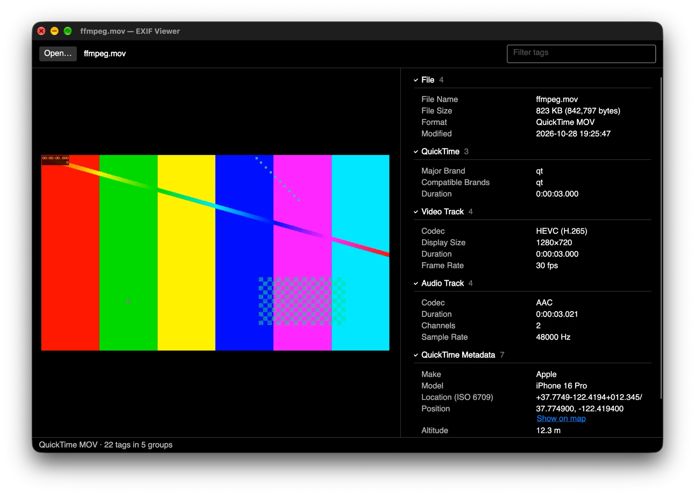

# EXIF Viewer

A cross-platform desktop app (macOS, Windows, Linux) that shows the metadata inside photos:
EXIF, GPS, XMP and container details, with a preview of the image.



**[Read the documentation](docs/Home.md)** for how to use the app and what all the data means.

## Dependencies

Few third-party packages, on purpose:

- **ExifViewer.Core** (the parser): none, only the .NET base library.
- **ExifViewer.App** (the UI): [Avalonia](https://avaloniaui.net/) (`Avalonia`, `Avalonia.Desktop`, `Avalonia.Themes.Fluent`).
- **Tests**: xUnit v3, dev only.

Versions live in `Directory.Packages.props`.

## Formats

| Format | What's read |
|---|---|
| JPEG | EXIF (APP1), XMP, JFIF, comments, frame header |
| PNG | eXIf, tEXt/zTXt/iTXt (incl. XMP), IHDR, tIME, pHYs |
| WebP | EXIF, XMP, VP8X/VP8/VP8L headers |
| TIFF, DNG (incl. Apple ProRAW), CR2, NEF, ARW, ORF, RW2, PEF | the TIFF structure: IFDs, Exif, GPS, Interop, SubIFDs, embedded JPEG previews |
| HEIC, HEIF, AVIF | brands, primary image size/rotation/colour, item list, auxiliary images (HDR gain map, depth, mattes), Exif and XMP items |
| MOV, MP4, M4V | movie header, per-track codec/size/rotation/frame rate/audio format, Apple `mdta` keys (make, model, location, Live Photo content identifier), iTunes-style tags, QuickTime user data |

Movies are read without their media data, so multi-gigabyte videos open instantly.

Not yet: CR3, IPTC, ICC profile contents, maker notes (including Apple's).

The preview is the file itself when the platform decoder handles it (JPEG, PNG, WebP), otherwise
the largest embedded JPEG (EXIF thumbnail or RAW preview), rotated by the EXIF orientation.
On macOS, anything else (HEIC, video, TIFF, RAW without an embedded preview) falls back to a
Quick Look thumbnail from the system's `qlmanage`. Other platforms show "No preview" for those,
since decoding HEVC/H.264 would need a codec library.

## Develop

Needs the .NET 10 SDK and [just](https://github.com/casey/just).

```bash
just run            # open the app
just run photo.jpg  # open a file
just test           # parser tests
just run-macos      # package the .app and open it
```

## Builds and releases

- **CI** (`.github/workflows/ci.yml`) builds and tests on macOS, Windows and Linux for every push to
  `main` and every pull request.
- **Releases** (`.github/workflows/release.yml`): push a tag like `v0.2.0` and the workflow runs CI,
  packages a universal macOS `.app`, a Windows x64 zip and a Linux x64 tarball (all self-contained,
  no .NET install needed), and publishes them as a GitHub release. Tags with a `-` (`v0.2.0-beta.1`)
  become pre-releases.
- Package locally with `just build-macos`, `just build-macos-universal`, `just build-windows` or
  `just build-linux`; output lands in `dist/`. Builds are ad-hoc signed on macOS and unsigned on
  Windows; set `MAC_SIGN_IDENTITY` to sign with a Developer ID.

## Layout

- `src/ExifViewer.Core/` – `MetadataReader` detects the container; `Containers/` reads JPEG, PNG,
  WebP, HEIF and QuickTime/MP4 (`IsoMedia` walks the shared box structure); `Tiff/` walks IFDs and formats tag values; `Xmp/` flattens XMP packets.
- `src/ExifViewer.App/` – the Avalonia window (code-behind, no MVVM framework).
- `tests/ExifViewer.Core.Tests/` – fixtures are built in code (`Fixtures.cs`), so the repo has no sample photos.
